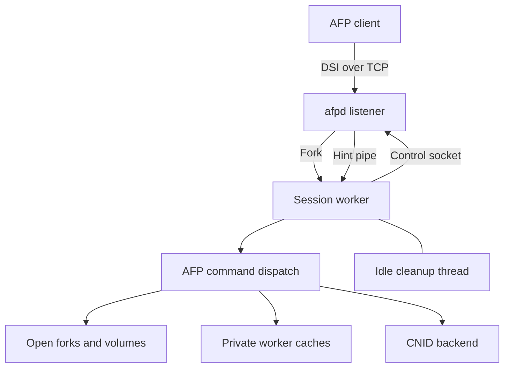
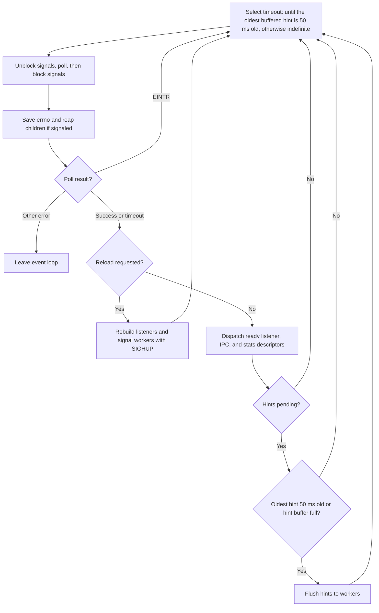
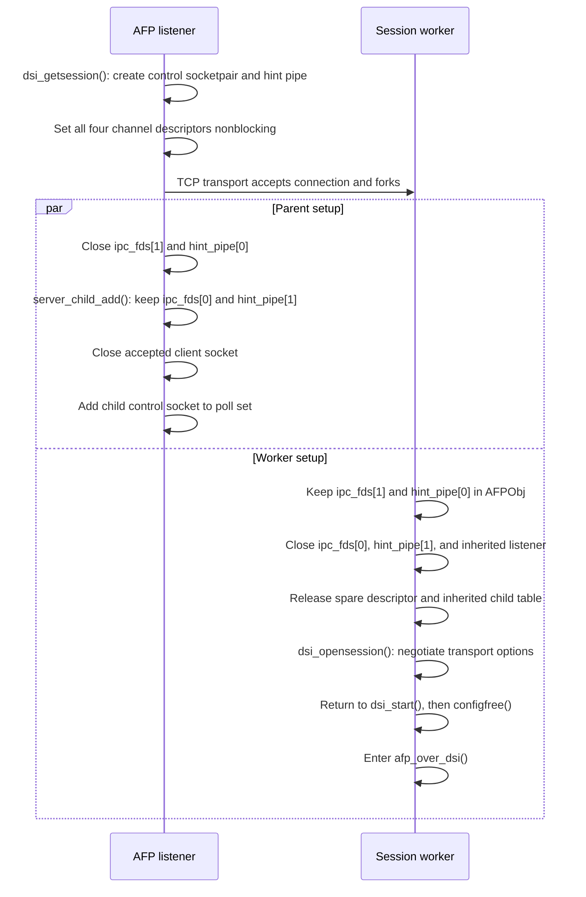
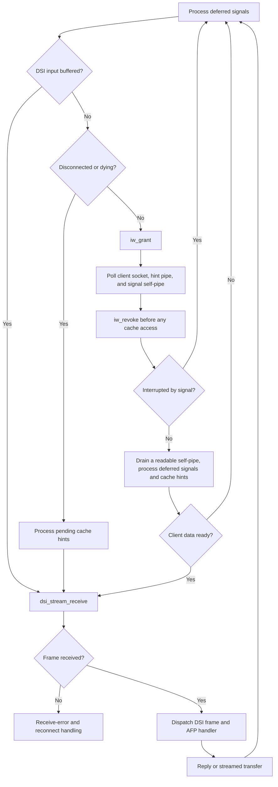

# AFP Daemon

The `afpd` daemon implements the AFP server with a process per connection.
Its parent listens for clients, forks session workers, and relays control
messages and cache hints. Each worker owns its authentication state, open
volumes and forks, transport buffers, and caches. The
[Netatalk Controller Daemon](netatalk.md) supervises the parent.

This chapter describes the TCP listener and DSI workers. Optional ASP
sessions use a separate transport path; see [AppleTalk](ddp.md).

## Key modules

| Location | Responsibility |
| --- | --- |
| `etc/afpd/main.c` | Listener initialization, poll loop, session startup, and parent signals |
| `libatalk/dsi/dsi_getsess.c`, `libatalk/dsi/dsi_tcp.c` | Session channels, TCP accept, and fork |
| `etc/afpd/afp_dsi.c`, `etc/afpd/switch.c` | DSI worker loop, signals, replay cache, and AFP dispatch |
| `etc/afpd/fork.h`, `etc/afpd/ofork.c`, `etc/afpd/fork.c` | Open-fork state, lookup, reference allocation, and AFP fork operations |
| `libatalk/util/server_child.c`, `include/atalk/server_child.h` | Child table, session state, and reconnect transfer |
| `libatalk/util/server_ipc.c`, `libatalk/util/sigpipe.c` | Control messages, cache hint relay, and signal wakeups |
| `etc/afpd/idle_worker.c`, `etc/afpd/idle_worker.h` | Deferred cleanup and cache-access handshake |

## Parent event loop

File-scope state in `main.c` includes `dsi_obj` and optional `asp_obj`
protocol objects, the `server_children` table, the `asev` poll descriptor
set, and `reloadconfig`/`gotsigchld` signal flags. The loop polls listening
sockets, child IPC sockets, and the optional afpstats Unix socket.

Buffered hints set the poll timeout to the time left until the oldest has
waited `HINT_FLUSH_INTERVAL_MS` (50 ms); otherwise poll blocks indefinitely.
Signals in the loop's set are unblocked immediately before poll and blocked
immediately afterward. The set includes SIGALRM, SIGHUP, SIGUSR1, and SIGCHLD.

The processing order preserves child-table and descriptor validity:

1. Save poll's `errno`, then reap children if `gotsigchld` is set.
   child_handler() removes their table entries and poll descriptors.
2. Handle poll errors using the saved value; reaping can overwrite `errno`.
   EINTR restarts the loop.
3. If `reloadconfig` is set, reset listeners, reparse configuration,
   initialize listeners, and signal workers with SIGHUP.
4. Dispatch ready descriptors: `LISTEN_FD` starts sessions, `IPC_FD` calls
   ipc_server_read(), and `STATS_FD` serves afpstats requests.
5. Flush the buffered hints once the oldest has waited 50 ms or the buffer
   holds `HINT_BUF_SIZE` (128), whether the poll timed out or found
   descriptors ready.

Descriptor activity does not postpone the flush: a batch goes out on the
first pass that reaches step 5 after its oldest hint has waited 50 ms.
Delivery and drop handling are covered by
[Caching and Consistency](caching.md).

## Session creation and channel ownership

dsi_start() calls dsi_getsession(), which creates a nonblocking control
socketpair and hint pipe before calling the transport's `proto_open` hook.
The TCP implementation accepts the connection and forks. The session cap
is checked before forking, with a second check when adding the child.

| Channel | Parent endpoint | Worker endpoint | Role |
| --- | --- | --- | --- |
| Control socketpair | `afpch_ipc_fd` | `AFPObj.ipc_fd` | Bidirectional state updates, outgoing hints, and reconnect transfer |
| Hint pipe | `afpch_hint_fd` (write) | `AFPObj.hint_fd` (read) | Incoming cache invalidation hints |
| Client socket | Closed after fork setup | DSI socket | AFP requests and replies |

The parent closes worker-side channel ends, records the child through
server_child_add(), closes its accepted client socket, and adds the control
socket to its poll set. The worker closes parent-side ends and inherited
listener state, frees its copy of the child table, and negotiates OpenSession.
It returns to dsi_start(), which releases unneeded configuration/listener
state through configfree() and enters afp_over_dsi(). A GetStatus request
has its own reply-and-exit path.

The successful OpenSession path splits into independent parent and worker
branches after fork:

Separate hint delivery keeps invalidations out of the reconnect descriptor
transfer stream. Bounded writes within `PIPE_BUF` do not interleave, but
pipe reads can be partial; receiver framing must preserve incomplete messages.

## Worker loop and dispatch

afp_over_dsi() initializes the directory cache, starts the optional idle
worker through iw_init(), applies socket options, and creates the signal
self-pipe. Failure to start the idle worker selects synchronous cleanup.

The loop processes deferred actions, and drains the signal self-pipe when
poll reports it readable; a self-pipe that poll reports broken ends the
session. It can consume already-buffered DSI input without polling.
Otherwise it polls the client socket, hint pipe, and signal self-pipe,
granting idle-worker access before the wait and revoking it immediately on
return. Revocation must precede signal actions, hint processing, and any
other cache access, including after EINTR. Disconnected/dying states have
separate receive paths; sleeping sessions still poll so reconnect and
shutdown can wake them.

The diagram follows ordinary frame processing. Reconnect and receive-error
handling can restart the loop, retain the session, or end it. Poll/descriptor
error paths are omitted; every poll return still revokes idle-worker access.

dsi_stream_receive() supplies a frame, and the worker dispatches DSICommand
or DSIWrite AFP operations through `afp_switch`. The handler returns a reply
or performs a streamed transfer. See [Request Processing](request-flow.md)
and [DSI over TCP](dsi.md) for operation and framing contracts.

The 256-entry `preauth_switch` and `postauth_switch` tables live in `switch.c`.
Before login, only afp_login(), afp_logincont(), afp_logout(), and
afp_login_ext() are available. set_auth_switch() enables authenticated
commands according to protocol version and features; UAMs can modify handlers.
See [Authentication and Session Identity](authentication.md).

The replay cache stores request ID, AFP command, and result code in
`replaycache[REPLAYCACHE_SIZE]`, indexed by `dsi->clientID % REPLAYCACHE_SIZE`
(128 slots). A matching repeated DSICommand can reuse the result without
running the handler again. A later request can replace the same cache slot.
DSIWrite bypasses this cache. Entries do not retain arbitrary full reply
payloads.

## Open-fork state

`struct ofork` binds an AFP fork reference to its volume, parent directory
CNID, filesystem device/inode key, shared `struct adouble`, and access/state
flags. Virtual forks additionally hold a data pointer and length.

`ofork.c` maintains two indexes: a 64-bucket device/inode hash table for
finding existing opens, and the `oforks` array for reference-number lookup.
The bucket uses the low inode bits; matching still checks file identity.
Reference lookup uses `refnum % nforks` and verifies the stored reference.
`nforks` is half the process descriptor limit, bounded to 2 through `0xffff`;
slot zero is reserved. The `of_freeq` FIFO supplies free slots without an
ordinary allocation scanning the whole array.

| Operation | Ownership effect |
| --- | --- |
| of_alloc() | Allocate a fork, assign its reference, index its identity, and acquire AppleDouble ownership |
| of_find() | Resolve and verify an AFP fork reference |
| of_findname() | Find an open file using filesystem identity |
| of_dealloc() | Unhash the fork, return its slot, and release its AppleDouble reference |
| of_closefork() | Flush required state, notify changes, close storage, and deallocate the fork |

The `AFPFORK_DATA`, `AFPFORK_RSRC`, and `AFPFORK_META` bits identify opened
storage, and `of_adflags` the AppleDouble forks the open took, which
of_closefork() releases; `AFPFORK_ACCRD` and `AFPFORK_ACCWR` record access.
write_fork() sets `AFPFORK_DIRTY` when the fork has open metadata, and
fork_modified() sets `AFPFORK_MODIFIED` at the fork's first write or length
change, when it also hints sibling sessions. `AFPFORK_ERROR`
and `AFPFORK_VIRTUAL` distinguish failed opens and virtual-file state.

Multiple forks of one file can share an AppleDouble object through ad_ref().
of_dealloc() releases that ownership and frees the object at zero references.
It does not perform the descriptor close or metadata flush required before
deallocation. Closing must release the fork even when flushing fails.
Metadata persistence, storage descriptors, and locks are discussed in
[Mac Metadata and Fork Storage](appledouble.md).

## Signals and session timers

The parent's afp_goaway() handles shutdown, login shutdown, reload, and
child-reaping flags. SIGPIPE and SIGXFSZ are ignored. The parent ignores
SIGHUP in single-user mode.

DSI workers install request-recording handlers through
afp_over_dsi_sighandlers(). The shared `atalk_sigpipe_*` API wakes the loop;
process_deferred_signals() performs actions in main-loop context after
reclaiming cache ownership.

| Signal | Installed handler | Deferred action |
| --- | --- | --- |
| SIGHUP | afp_dsi_reload() | Reload volume configuration in normal mode |
| SIGURG | afp_dsi_transfer_handler() | Receive a transferred socket and resume the session |
| SIGTERM / SIGQUIT | afp_dsi_die_handler() | Close/exit with the recorded cause |
| SIGUSR1 | afp_dsi_timedown_handler() | Begin the five-minute shutdown path |
| SIGUSR2 | afp_dsi_getmesg_handler() | Deliver server-message attention |
| SIGINT | afp_dsi_debug() | Dump caches and toggle debug logging |
| SIGALRM | alarm_handler() | Process tickles and state-dependent timeouts |

alarm_handler() records pending work; handle_alarm() performs timer actions.
Recent `DSI_DATA` clears the idle indication. Otherwise tickles advance and
active, sleeping, disconnected, or dying sessions follow their own limits.
The parser converts `sleep time` and `disconnect time` from hours to tickles.
Transport loss can retain authenticated open state for primary reconnect.

## Idle cleanup and cache ownership

Each worker owns directory, AppleDouble metadata, and resource-fork caches.
Its idle thread frees queued invalidated entries and scans deferred
child-removal chains only during a granted poll window.

iw_note_work() records queued work; iw_grant() permits cleanup when work is
pending, and iw_revoke() waits for exclusive main-thread access to return.
The `iw_has_work`, `iw_can_work`, and `iw_is_working` handshake uses
sequentially consistent atomics:

| Flag | Ownership rule |
| --- | --- |
| `iw_has_work` | Main thread sets it after enqueue; worker clears it only after a full drain |
| `iw_can_work` | Main thread grants access immediately before poll when work is pending and revokes it on return |
| `iw_is_working` | Worker publishes it before rechecking the grant; main thread waits for it to clear after revocation |

The publish/recheck ordering ensures that either the worker observes a
revoked grant before touching queues or the main thread waits for its
release. Weakening that ordering can allow concurrent cache access. The
worker rechecks the grant before each invalid entry free and each deferred
child removal.

The worker wakes with nanosleep() at `IW_WAKE_MS` (10 ms). iw_wait_release()
first checks for release, then uses a bounded relax spin followed by 100 µs
sleeps. Platforms without always-lock-free integer atomics use synchronous
stubs. If no worker is active, the DSICommand handler calls
dir_free_invalid_q() synchronously.

iw_shutdown() joins the thread on session exit and abandons queued work
because the process exits immediately afterward. Exit paths through
afp_dsi_close() also use iw_revoke_signal_safe(), which revokes without
waiting and cannot establish a window for ordinary cache access.
Session teardown closes forks and volumes. The queue and invalidation
contracts are in [Caching and Consistency](caching.md).

## Child tracking and reconnect

`server_child_t` holds the current count, session limit, and a 32-bucket
table of `afp_child_t` records. The PID hash is
`((pid >> 8) ^ pid) & (CHILD_HASHSIZE - 1)`. Each record owns parent-side
control/hint descriptors and tracks UID, client identity and boot time,
login time, reconnect token, hostname, session state, and mounted volumes.

server_child_add() enforces the session limit. server_child_remove()
unlinks the entry, closes its descriptors, frees its state, and returns the
former IPC descriptor so the parent can remove it from the poll set.
server_child_free() releases the inherited table in a forked worker;
server_child_kill() signals tracked sessions.

`IPC_SESSIONTOKEN` publishes an opaque random eight-byte token through
server_child_set_session_token(). server_child_transfer_session() validates
the token and requesting UID, transfers the new socket and DSI request ID,
and wakes the retained worker with SIGURG. The worker receives the socket
in ordinary loop context. See
[Authentication and Session Identity](authentication.md) for token security
and protocol compatibility constraints.
