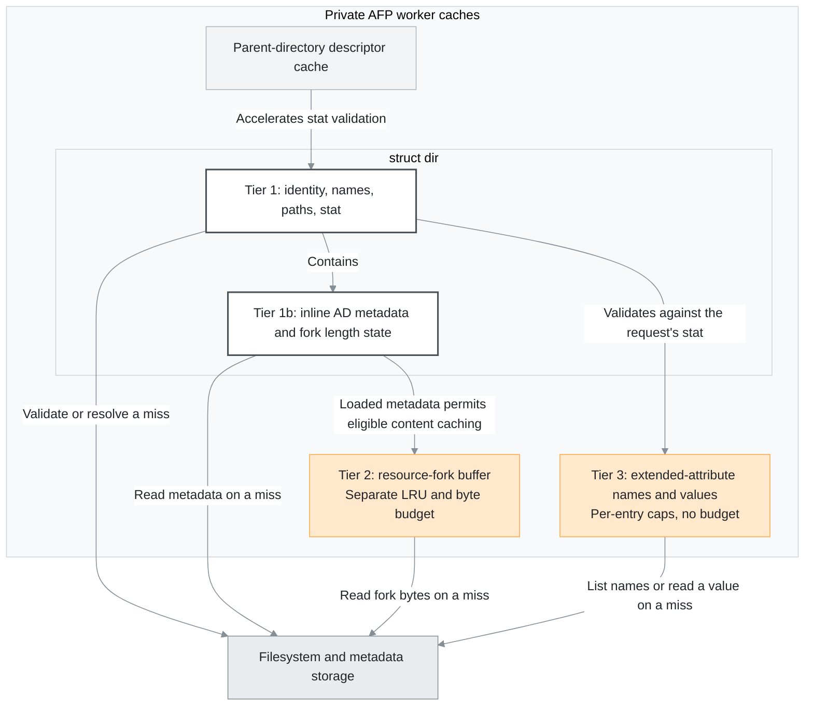
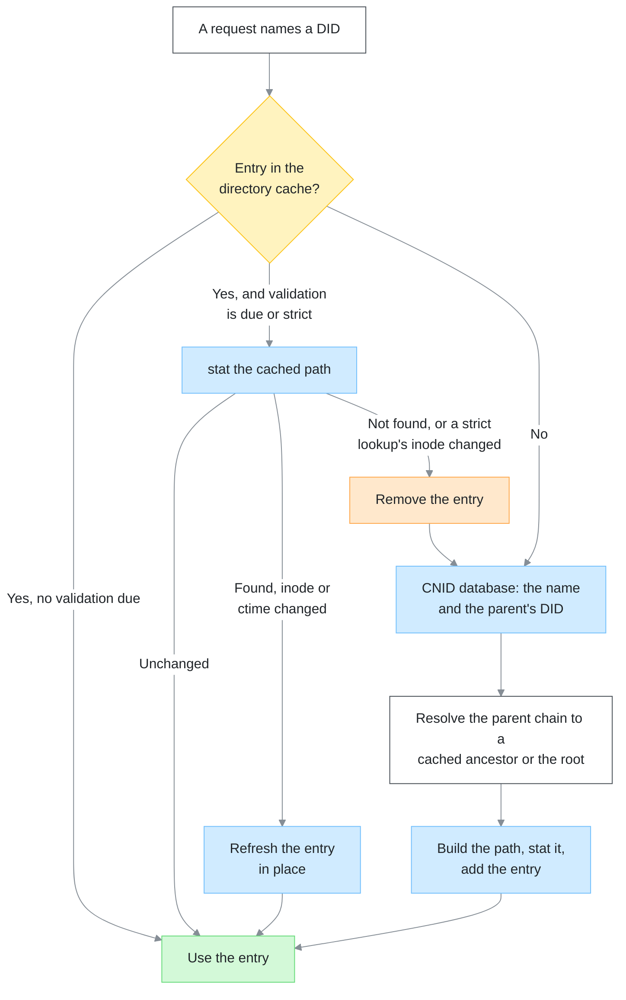
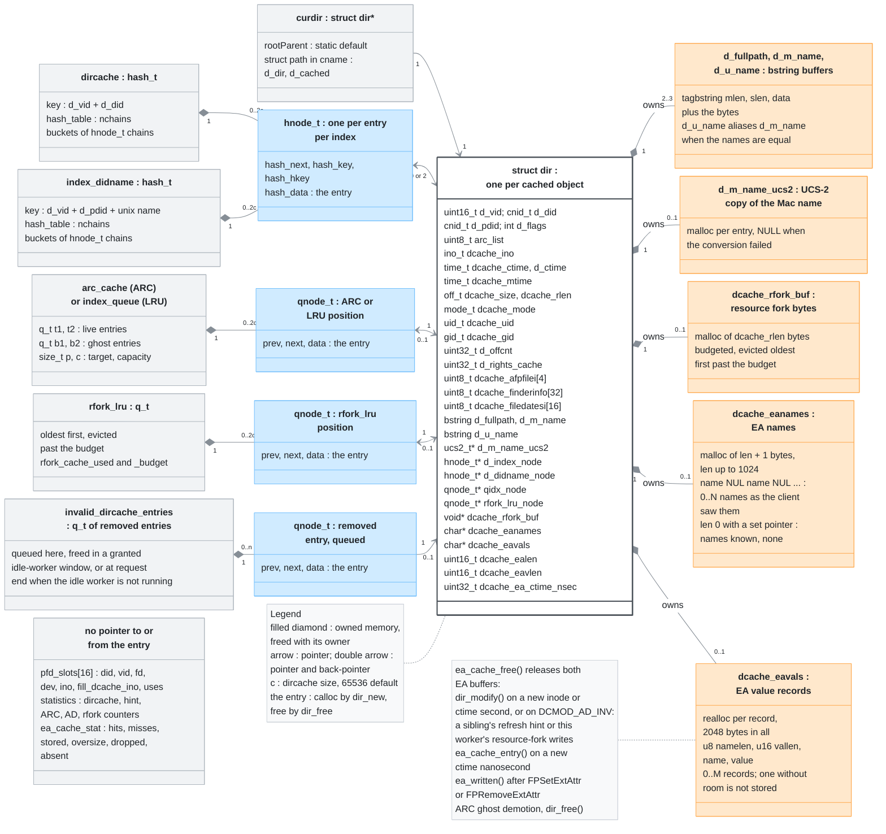
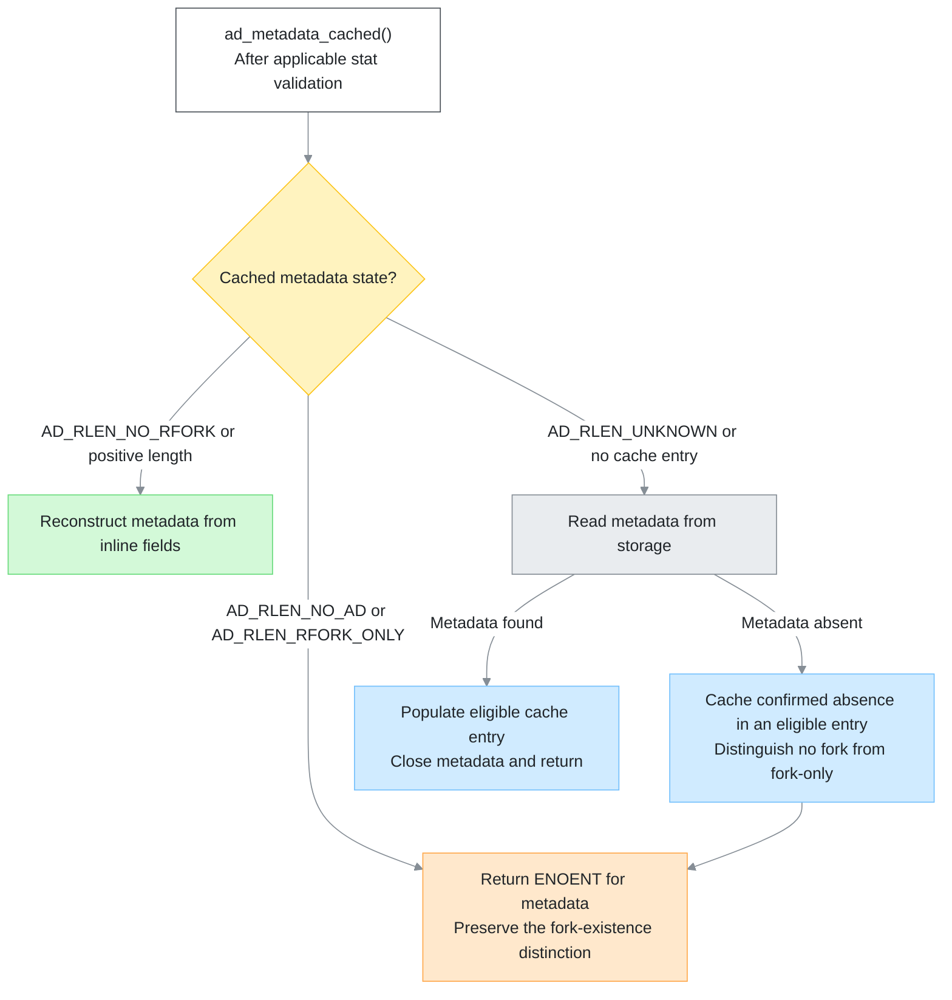
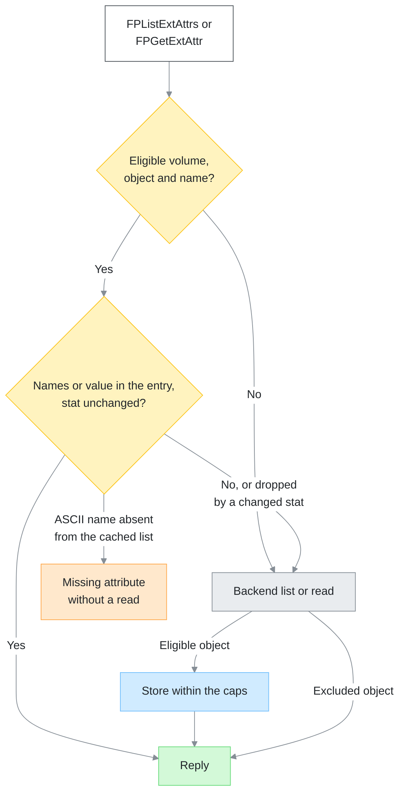
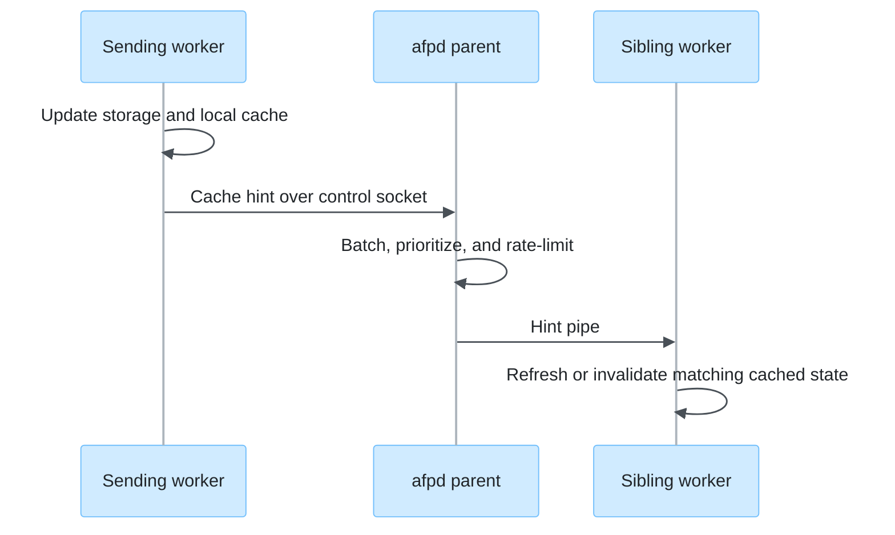

# Caching and Consistency

Each AFP worker owns its caches: directory-cache entries, inline AppleDouble
metadata, resource-fork buffers, extended-attribute names and values, and
parent descriptors. Workers share persistent files and CNID records, but do
not share cache memory. Coherence is the worker's duty. A worker that changes
an object must update persistent state first, then repair local cached state,
then let other sessions discover the change. Ordinary IPC hints accelerate
that discovery, but filesystem validation remains necessary, especially when
local tools or other file servers change a volume.

## Why the worker caches

An AFP request names objects by ID. Without a cache, every ID costs a CNID
database query and a stat of the path. Each ancestor up to the volume root
costs the same again. The kernel's dentry and inode caches absorb those
stats only while the tree fits in them, and they compete with the page
cache for memory. A client that browses a large tree stats thousands of
inodes per listing. That churns those caches and evicts data every process
on the host still needs.

The directory cache keeps identities, names, paths, and stat fields in the
worker's own memory. A cached lookup costs no syscall, and sampled
validation lets all but every Nth lookup skip the stat.

An undersized cache undoes the gain. Under LRU, an evicted ancestor forces
recursive lookups and stats to rebuild paths as the working set rotates.
ARC keeps evicted entries as ghosts and revives them without a CNID query,
so its cascade starts once rotation exceeds the live and ghost capacity.
`dircache size` should cover the working set.

## Modules

The modules below hold the cache code.

| Location | Responsibility |
| --- | --- |
| `etc/afpd/dircache.c`, `include/atalk/directory.h` | Cached identities, names, stat data, replacement, and invalidation |
| `etc/afpd/directory.c` | Entry creation, modification, invalidation, and freeing |
| `etc/afpd/ad_cache.c` | Inline AppleDouble metadata, resource-fork content, and extended-attribute caching |
| `etc/afpd/fork.c` | The resource-fork cache's admission gate |
| `etc/afpd/ofork.c` | The entry behind an open fork, resource-fork change and hold tests, and sibling hints |
| `etc/afpd/extattrs.c` | Extended-attribute handlers that fill and drop the entry's names and values |
| `etc/afpd/pfd_cache.c` | Parent-directory descriptors used for relative stat |
| `etc/afpd/enumerate.c` | Saved directory listings and their session-close statistics |
| `etc/afpd/idle_worker.c`, `etc/afpd/afp_dsi.c` | Deferred cleanup and exclusive cache-access scheduling |
| `etc/afpd/volume.c` | The CNID reset hint with its volume tag, and the deferred-work flush at volume close |
| `libatalk/util/server_ipc.c`, `include/atalk/server_ipc.h` | Hint serialization, relay, and delivery policy |
| `etc/afpd/main.c` | The parent loop that flushes batched hints when they are due |
| `libatalk/util/netatalk_conf.c` | The `multi protocol` defaults and the `dircache mode` setting |

## Cache tier overview

Four tiers and a supporting cache hold the worker's cached state. Tier 1
is the directory cache's entries. Tier 1b is the AppleDouble metadata
inside them. Tiers 2 and 3 are the resource-fork and extended-attribute
buffers attached to those entries. The parent-descriptor cache accelerates
filesystem validation alongside these tiers. Entries also cache access
rights and offspring counts, and enumeration keeps up to eight saved
directory listings outside the tiers.

| Tier | Cached data | Storage | Replacement and validity |
| --- | --- | --- | --- |
| Tier 1: directory cache | File/directory identities, names, paths, stat fields, access rights, and offspring counts | `struct dir` entries in identity and parent/name hash indexes | ARC or LRU. Sampled filesystem validation and explicit mutation and invalidation paths |
| Tier 1b: AppleDouble metadata | Finder information, dates, AFP attributes, and resource-fork length state | Inline fields in `struct dir` | Shares the entry lifecycle. Inode or ctime changes invalidate it. Metadata mutations refresh or invalidate it |
| Tier 2: resource-fork content | Resource-fork bytes for eligible files | Allocated buffers attached to `struct dir` | Separate LRU and byte budget with a per-entry limit. Invalidated with the metadata |
| Tier 3: extended attributes | The object's attribute names, and the values a client read | Allocated buffers attached to `struct dir` | Released at ARC ghost demotion and with the entry. Validated against the stat each request takes. Per-entry caps, no budget |
| Supporting cache: parent-directory descriptors | Open parent descriptors keyed by volume and parent DID | Separate descriptor slots | MRU ordering with LRU replacement, purge hooks, and absolute-path re-grounding every 256 uses |

Figure 1 shows the tiers' dependencies and their storage access.

Figure 1: the cache tiers, their dependencies, and their storage access

Each AFP command uses only the caches its parameters or fork operation
need.

## How a lookup resolves

A request names a directory or file by its DID, and `dirlookup()` searches
the directory cache by volume and DID. On a hit, an optimistic lookup
validates the entry only when the sample falls due. A stat that still
finds the path refreshes the entry in place when the inode or ctime
changed. A stat that fails removes the entry, and the lookup resolves the
DID again. A strict lookup on a write path stats every entry but the root
ones. It removes and re-resolves on a failed stat or a changed inode.

On a miss, the CNID database returns the object's name and its parent's
DID. The same resolution, strict, walks the parent chain until a cached
ancestor or the volume root. The lookup then builds the full path, stats
it, and adds the entry. It cleans a path the stat no longer finds from the
cache and retries through the CNID database once per level. Figure 2 shows
the order.

Figure 2: how a DID resolves through the cache, the CNID database, and the filesystem

The filesystem is the authority. The CNID database is the persistent map
from an ID to a name and a parent. The cache is the fast path in front of
both, and every other process shares the page cache beneath them.

## Cache roles and replacement

ARC or LRU replaces directory-cache entries. AppleDouble metadata and
extended-attribute buffers have no separate replacement, while
resource-fork content and parent descriptors do. A live entry does not
imply cached resource-fork content. Parent-directory descriptors live in a
separate cache of 16 slots, independent of the entries' lifetime.

The directory cache indexes `struct dir` entries by identity and by
parent/name. Entries can represent files as well as directories. ARC is
the default replacement policy, with LRU selectable. ARC separates recent
and frequent entries into T1/T2 lists and keeps evicted entries as ghosts
in B1/B2 lists. Ghost hits adapt the ARC target `p`, the recency/frequency
balance. The ARC ghost lists hold full entries, not keys.

## Memory layout and footprint

An entry is 232 bytes on a 64-bit build. Each entry also owns two or three
name strings: `d_u_name` aliases `d_m_name` when the two names are equal.
It owns its Mac name in UCS-2 when that conversion succeeded. Its two hash
nodes take 32 bytes each and its queue nodes 24 each. It holds one queue
node for its ARC or LRU position, another for a cached resource fork, and a
third while it awaits freeing.

The default `dircache size` of 65536 entries holds 14.5 MiB of entry
structs before names. ARC keeps up to `dircache size` ghost entries beside
the live ones: up to another 14.5 MiB of entry structs, which counts in
cache sizing.

Figure 3 shows where the cached state lives and what points at what.
Every relation carries its multiplicity, where `c` is the `dircache size`.

Figure 3: the session's containers, their index nodes, the entry's fields, and the heap buffers the entry owns

The extended-attribute tier adds at most 1 KiB of names and 2 KiB of value
records to a live entry. It stores them only after a client lists or reads
them. An object without attributes holds a 1-byte names buffer after a
client lists them.

The tier has no budget: `dircache size` bounds it, because ghosts hold no
attribute buffers. The ceiling is 3 KiB per entry, plus the names buffer's
1-byte terminator. That is 192 MiB at the default size and 3 GiB at the
maximum of 1048576 entries. Reaching it needs every cached object to fill
both caps. A cache of the maximum size whose entries average 1 KiB of names
and values holds 1 GiB of them.

The attributes macOS itself writes to a downloaded file are smaller than
the caps. On macOS 26 the file carries a `com.apple.quarantine` value of
58 bytes and a `com.apple.metadata:kMDItemWhereFroms` value of 254 bytes.

## Validation and external changes

Validation compares the inode and ctime before reusing cached state.
Mutation paths must invalidate the affected stat, metadata, names,
extended attributes, and resource-fork content coherently. Updating one
cached field cannot establish that the others remain valid.

`dircache validation freq` sets N, and the worker validates every Nth
eligible lookup: 1 validates every one, while larger values reduce stat
work. Eligible lookups are the DID and parent/name searches that find an
entry. The default of 100 favors AFP-only writers. Sampling trades
validation cost for a window in which external changes can remain
undiscovered. The setting is not a time-to-live or a set number of seconds
of freshness.

`multi protocol = yes` supplies validation frequency 1 and strict-locking
defaults unless explicitly overridden. It also excludes the volume from
extended-attribute caching, and from resource-fork caching unless the
configuration sets `dircache rfork budget` explicitly. The validation and
locking defaults change process options, so they also reach other volumes
loaded in that worker. `multi protocol` does not select storage
conventions: `ea = samba` does.

`pfd_ostat()` accelerates validation with a cached parent descriptor and
relative stat, falling back to a full path when needed. An inode change
that `dir_modify()` applies to a directory purges its descriptor.
Re-grounding by absolute path on a slot's 256th use detects external
replacement. Until a purge or re-grounding catches the replacement, a held
descriptor can still name the older object, even with validation
frequency 1.

## AppleDouble and resource-fork validity

`ad_metadata_cached()` is the read-only metadata entry point. It reconstructs
metadata from a valid cache entry or reads storage and populates the entry.
Callers that pass `strict` validate before reuse. A non-strict caller
that passes a recent stat result validates against that result. Callers
needing writable descriptors must open them explicitly.

The resource-length field, `dcache_rlen`, encodes metadata state as well as length:

| State | Meaning |
| --- | --- |
| `AD_RLEN_UNKNOWN` | Metadata not loaded or invalidated |
| `AD_RLEN_NO_AD` | No metadata and no resource fork |
| `AD_RLEN_RFORK_ONLY` | Resource fork exists without metadata. Its length is not cached here |
| `AD_RLEN_NO_RFORK` / positive length | Metadata cached, with an empty/nonempty resource fork |

Figure 4 shows metadata cache selection after the applicable inode/ctime
validation. A detected change invalidates cached metadata before selection.
The flow omits storage errors and cache-population eligibility.

Figure 4: metadata cache selection after stat validation

A metadata-cache change must preserve whether the fork exists when metadata
is absent. Resource-fork buffers depend on loaded metadata and must be
invalidated with it.

Resource-fork cache admission tests the per-entry size and the volume
policy. It also needs a known positive length and a read through a fork
opened without write access. No other worker may hold the fork open for
writing. It then evicts the oldest buffers until the fork fits the byte
budget, and refuses when it still does not. A guard also refuses while the
cache holds more than twice its budget, a state eviction prevents.

Short reads invalidate the cached metadata instead of publishing a
partially populated fork buffer. Configuration budgets use KiB, while
runtime accounting uses bytes.

## Extended-attribute names and values

An object's entry can hold the names its extended-attribute backend listed
and the values a client has read. FPListExtAttrs and FPGetExtAttr then reply
without a backend call. Each request takes a fresh stat of the object. The
entry serves a cached list or value only while its inode and ctime match
that stat, to the nanosecond where the filesystem keeps one.

A cached list answers an FPGetExtAttr for an ASCII name it lacks as a
missing attribute, without a read. The match ignores case. A name with
other bytes takes the backend path. The list holds names as the client saw
them, the lookup uses the backend's form, and only ASCII is the same in
both.

The cached names and values drop on an inode or ctime change, and whenever
`dir_modify()` invalidates the entry's AppleDouble metadata. A sibling's
refresh hint does that, and so do this worker's own resource-fork writes.
An FPSetExtAttr or FPRemoveExtAttr through this worker that reaches the
backend drops them too, whatever its result. They also drop when the entry
becomes an ARC ghost or when `dir_free()` releases it.

An entry keeps names and value records up to the caps in Memory layout
and footprint. A list over its cap, or a value the entry has no room for,
costs a backend read on every request.

Volumes with `multi protocol = yes`, symlinks, and `kXAttrNoFollow`
requests on volumes that follow symlinks stay outside the tier. So do the
names afpd withholds from clients: those the `NOT_NETATALK_EA` filter
hides from the list, and those `sys_ea_protected()` refuses. Figure 5
shows how the entry serves a request or passes it to the backend.

Figure 5: an extended-attribute request against the entry

## Cross-process hints

A worker that changes an object sends a hint to the afpd parent over the
control socket. The parent relays it to the sibling workers, as Figure 6
shows.

Figure 6: a cache hint from the sending worker to its siblings

Ordinary hints request refresh, deletion, or child invalidation. The parent
excludes the sender from the relay. It batches bounded writes to sibling
hint pipes. Pipe writes within `PIPE_BUF` are atomic, but reads can be
partial, so the receiver retains incomplete message bytes for the next
read.

A nonblocking write that finds no room at the sender or the receiver can
drop an ordinary hint. So can a rate limit or a full parent buffer of 128
hints. A failed write to a sibling's pipe skips the rest of that sibling's
batch.

The parent sends a batch once its oldest hint is 50 ms old or the buffer
is full. Each batch relays one refresh per sender and object.

A CNID reset has a consequence beyond a refresh: every client reference in
the reset volume's identity space is obsolete. `CACHE_HINT_VOLUME_RESET`
carries a UUID-derived volume tag, not a process-local volume ID. Matching
sessions terminate so their clients obtain fresh IDs. Reset hints have
separate priority, rate limiting, bounded delivery handling, and logged
failures. Each reset the parent accepts flushes its buffer at once.
[Persistent File Identity](cnid.md) describes the identity space.

FCE notifications have external consumers and are independent of this
relay. The relay does not promise immediate or lossless coherence, nor
does it cross hosts.

## Deferred cleanup and exclusive access

Large invalidations can enqueue work instead of freeing every entry or
scanning every descendant at once. Deferred work has two types:
freeing invalidated entries, and scanning hash chains for the children of
removed, renamed, or moved directories. When the idle worker is not running
or the child-scan ring holds 5120 jobs, the request removes the children
itself. The invalid-entry queue has no bound.

The idle worker (cleanup thread) consumes child-scan jobs LIFO, because a
bottom-up deletion queues the covering ancestor last. A completed scan
memoizes its volume, byte path, and scan-start sequence. Only jobs queued
before that scan and at or below its path can be canceled as covered.

A flat burst of sibling-directory removals leaves every pending job at one
depth. One merged hash-table scan then covers them, when they number two
or more. It matches each entry's candidate ancestor against sorted member
paths. A newer job can represent new work, so the memo's volume, path, and
sequence tests and the batch's sequence test must stay.

The idle worker runs cache work only inside a window the main thread
grants with `iw_grant()` and ends with `iw_revoke()`. That window opens
while the thread waits in `poll()` for client data.
[AFP Daemon](afpd.md#idle-cleanup-and-cache-ownership)
describes the producer/grant/revoke API, atomic handshake, synchronous
fallback, and session-exit behavior. Queue changes must preserve that
exclusive-access contract. `pfd_ostat()` is main-thread-only, while
descriptor purge hooks may run in a granted idle-worker window. Volume close
flushes its deferred work before releasing state.

## Statistics and interpretation

Session-close logs expose the following groups. The lines start with
`dircache statistics (LRU)` or `(ARC)`, `(AD)`, `(rfork)`, `(EA)`,
`(offcnt)`, and `(hints)`, with `enumerate statistics:`, `pfd_cache:`,
and `iw stats:`. ARC mode adds four lines: `ARC ghost performance:`,
`ARC table state:`, `ARC adaptation:`, and `ARC operations:`. The
resource-fork line appears only when `dircache rfork budget` is nonzero,
and the idle-worker line only when the thread started.

| Group | Useful measurements |
| --- | --- |
| Common directory cache | `entries`, `max_entries`, `config_max_entries`, `lookups`, `validations`, `added`, `removed`, `expunged`, `invalid_on_use`, `evicted`, `covered_cancelled`, `validation_freq` |
| LRU | Hits and misses |
| ARC | Active, ghost, and total hits, B1/B2 learning benefit, T1/T2/B1/B2 sizes, frequency bias, target `p` with its range, adaptations, promotions, and evictions |
| AD metadata | Hits, misses, and cached absent-metadata results |
| Resource forks | Entries, the peak in MB with its share of the budget, lookups, hits/misses, additions, evictions, and invalidations |
| Extended attributes | Hits, misses, stores, oversize lists or values, drops, and names a cached list proved missing |
| Offspring counts | `requests`, `cached`, `walked` with its `first`, `older`, `confirmed`, and `changed` kinds, `failed`, and `entries` |
| Directory listings | Reads, continuation rereads, and names read |
| Hints | Sent/dropped, received, acted on, and unmatched |
| Parent descriptors | Hits, opens, refreshes, re-grounds, fallbacks, purges, and path repairs |
| Idle worker | Work noted, grants, started/completed/interrupted/aborted cycles, invalid entries freed, and hash-chain work |

The workload, the validation policy, and cache warm-up set what each count
means, so no hit-rate target applies to every server. The directory-cache
counters read as follows.

| Counter | Meaning |
| --- | --- |
| `entries`, `max_entries`, `config_max_entries` | Entries at close, the session's peak, and the configured maximum |
| `lookups`, `hits`, `misses` | Cache searches, those a live entry served, and those that missed or expunged a stale entry |
| `validations` | Approximate count of sampled stats |
| `added`, `removed`, `evicted` | Entries created, removed by a mutation or invalidation, and dropped for capacity under LRU or demoted to ghosts under ARC |
| `expunged`, `invalid_on_use` | Stale entries validation caught, and staleness found on use |
| `covered_cancelled` | Deferred child scans an ancestor's scan or a merged flat scan made redundant |
| `ghost_hits`, `total_hits`, `learning_benefit` | ARC lookups served from B1/B2, hits plus ghost hits, and the ghost share of lookups |
| `T1`, `T2`, `B1`, `B2`, `freq_bias` | The four list sizes, and the share of cached entries in T2 |
| `p`, `p_range`, `adaptations` | ARC's target size for T1, its observed range, and the adjustments made |

A `freq_bias` near 100% means repetitive reuse, and one near 0% a
sequential pass. Increases of `p` favor recency and decreases favor
frequency. A rising `invalid_on_use` count calls for a
`dircache validation freq` below the current value. A count near zero over
a long session allows a value up to the maximum of 100. An `evicted` count
that keeps rising on a warm cache calls for a `dircache size` above the
current value, and `max_entries` shows how much of it a session used.

`expunged` records entries caught by validation, and stale duplicates
retired at insert or reindex. `invalid_on_use` records staleness
discovered on use. Validation's expunges raise it too, because
`dir_remove()` reports them as invalid. Ghost hits are real reuse in this
implementation, but must be distinguished from live T1/T2 hits when
interpreting ARC. `validations` is an approximate sampled count.

Under LRU, `evicted` grows by 256 per eviction pass.

A canceled covered job saves duplicate work, and is not necessarily a
missed invalidation. Idle-worker `interrupted` cycles leave work for
another grant. `aborted` cycles had their grant revoked before touching
queues. Chain counts measure hash-chain work, not numbers of files freed.
`dropped` counts only this worker's sends that met a full control socket,
because the parent's drops reach no log.

Evictions and misses that continue after warm-up can indicate a cache
undersized for the working set. Rising `invalid_on_use` counts call for
investigating external changes and validation behavior. Path repairs count
this worker's own directory renames and moves whose deferred child scan is
still pending. `invalid_on_use` misses a stale entry that no request used,
so even a count of 0 does not prove that skipped validations were safe.

Outside afpd, the page cache's scan rate, the volume's read IOPS, and the
filesystem's own cache hit ratio show what validation sampling saves.
[Performance Analysis](profiling.md) gives the measurement methodology.
[Diagnostics](logging.md) covers collecting dumps.
