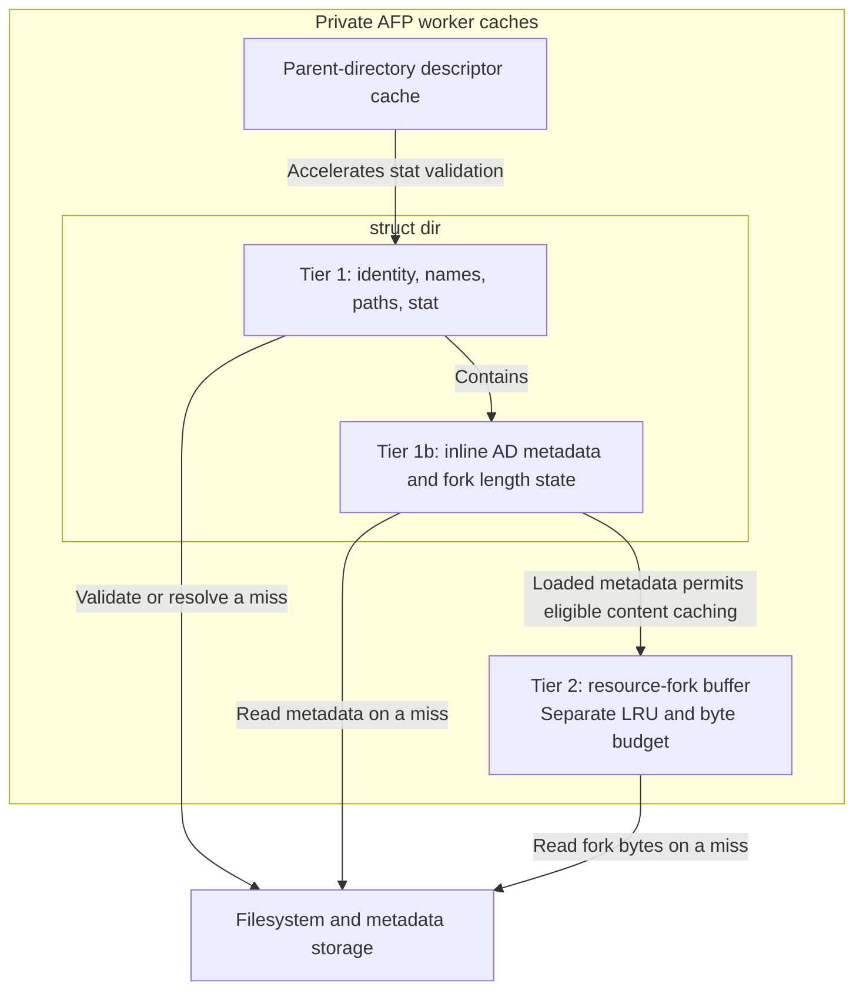
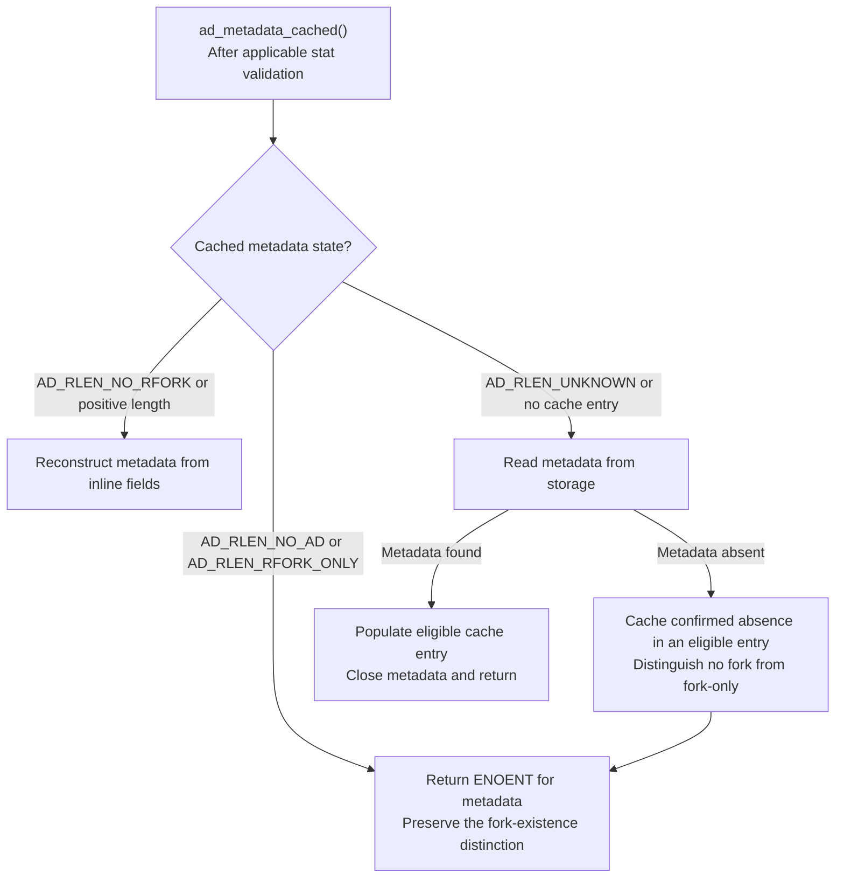
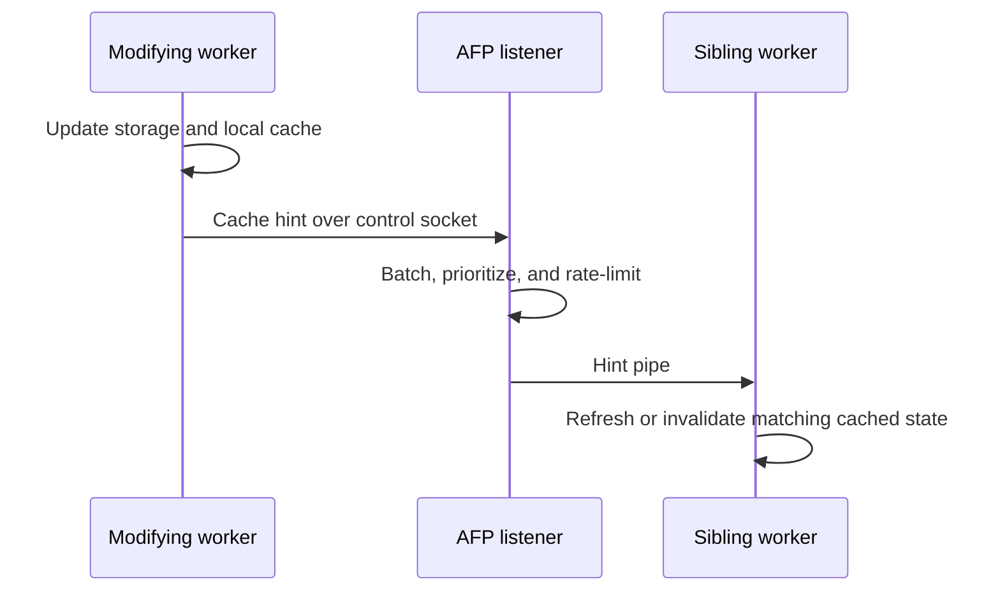

# Caching and Consistency

Each AFP worker owns its caches. Workers share persistent files and CNID
records, but do not share cache memory. A mutation must update persistent
state, repair local cached state, and let other sessions discover the change.
Ordinary IPC hints accelerate that discovery; filesystem validation remains
necessary, especially when local tools or other file servers modify a volume.

## Key modules

| Location | Responsibility |
| --- | --- |
| `etc/afpd/dircache.c`, `include/atalk/directory.h` | Cached identities, names, stat data, replacement, and invalidation |
| `etc/afpd/ad_cache.c` | Inline AppleDouble metadata and resource-fork content caching |
| `etc/afpd/pfd_cache.c` | Parent-directory descriptors used for relative stat |
| `etc/afpd/idle_worker.c`, `etc/afpd/afp_dsi.c` | Deferred cleanup and exclusive cache-access scheduling |
| `libatalk/util/server_ipc.c`, `include/atalk/server_ipc.h` | Hint serialization, relay, and delivery policy |

## Cache tier overview

The tier names distinguish cached identities and metadata from cached fork
bytes. Tier 1b lives inside Tier 1 entries; Tier 2 attaches separately
allocated buffers to those entries. The parent-descriptor cache supports
filesystem validation alongside these tiers.

| Tier | Cached data | Storage | Replacement and validity |
| --- | --- | --- | --- |
| Tier 1: directory cache | File/directory identities, names, paths, and stat fields | `struct dir` entries in identity and parent/name hash indexes | ARC or LRU; sampled filesystem validation and explicit mutation/invalidation paths |
| Tier 1b: AppleDouble metadata | Finder information, dates, AFP attributes, and resource-fork length state | Inline fields in `struct dir` | Shares the directory entry lifecycle; inode/ctime changes and metadata mutations invalidate it |
| Tier 2: resource-fork content | Resource-fork bytes for eligible files | Allocated buffers attached to `struct dir` | Separate LRU and byte budget, with a per-entry limit; invalidated with metadata |
| Supporting cache: parent-directory descriptors | Open parent descriptors keyed by volume and parent DID | Separate descriptor slots | MRU ordering with LRU replacement, purge hooks, and periodic absolute-path re-grounding |

The arrows show dependencies and storage access. Each AFP command uses the
caches relevant to its parameters or fork operation; commands do not all
traverse every tier.

## Cache roles and replacement

The directory cache indexes `struct dir` entries by identity and by
parent/name. Entries can represent files as well as directories. ARC is
the default replacement policy; LRU is selectable. ARC separates recent
and frequent entries into T1/T2 lists and tracks their evicted history in
B1/B2 lists. Ghost hits adapt the recency/frequency balance.

Netatalk retains full directory objects in its ARC ghost lists. These are
not merely key-only histories, and their memory belongs in cache sizing.
The configured live-entry limit is not the entire memory footprint.

AppleDouble metadata is stored inline in directory entries. Resource-fork
content has a separate byte budget and LRU list; a live directory entry
does not imply that its resource bytes are cached. Parent-directory
descriptors form another small cache and have a separate lifetime.

## Validation and external changes

`dircache validation freq` controls sampled filesystem validation of eligible
lookups: 1 validates every eligible lookup, while larger values reduce stat
work. The default favors AFP-only writers. This trades validation cost for
a window in which external changes can remain undiscovered. It is not a
time-to-live or a fixed number of seconds of freshness.

Validation checks filesystem identity and change information before reusing
cached state. An entry found stale during actual use is reported separately
from one caught by validation. Mutation paths must invalidate the affected
stat, metadata, names, and resource bytes coherently; updating one cached
field cannot establish that the others remain valid.

`multi protocol = yes` supplies per-access validation and strict-locking
defaults unless explicitly overridden. It also excludes the volume from
resource-fork caching unless the Global budget was explicitly configured.
The first two controls affect process options, including other volumes
loaded in that worker. `ea = samba` selects storage conventions separately.

pfd_ostat() accelerates validation with a cached parent descriptor and
relative stat, falling back to a full path when needed. Slots are keyed by
volume and parent DID. Learned parent changes invalidate descriptors, and
periodic absolute-path re-grounding detects external replacement. A held
directory descriptor can continue naming an older object during that
convergence window, even with validation frequency 1.

## AppleDouble and resource-fork validity

ad_metadata_cached() is the read-only metadata entry point. It reconstructs
metadata from a valid cache entry or reads storage and populates the entry.
Strict callers validate before reuse; a non-strict caller with a recent
stat result also checks that known information. Callers needing writable
descriptors must open them explicitly.

The resource-length field encodes metadata state as well as length:

| State | Meaning |
| --- | --- |
| `AD_RLEN_UNKNOWN` | Metadata not loaded or invalidated |
| `AD_RLEN_NO_AD` | No metadata and no resource fork |
| `AD_RLEN_RFORK_ONLY` | Resource fork exists without metadata; its length is not cached here |
| `AD_RLEN_NO_RFORK` / positive length | Metadata cached, with an empty/nonempty resource fork |

The following flow shows metadata cache selection after the applicable
inode/ctime checks. A detected change invalidates cached metadata before
selection. Storage errors and cache-population eligibility are omitted.

Preserve the distinction between absent metadata and an absent fork.
Resource buffers depend on loaded metadata and must be invalidated with it.
Cache admission checks the per-entry size, volume policy, and remaining
byte budget. Short reads invalidate the cached metadata instead of
publishing a partially populated fork buffer. Configuration budgets use
KiB, while runtime accounting uses bytes.

## Cross-process hints

Ordinary hints request refresh, deletion, or child invalidation. The parent
excludes the originating worker and batches bounded writes to sibling hint
pipes. Pipe writes within `PIPE_BUF` do not interleave, but reads can be
partial; the receiver retains incomplete message bytes for the next read.

Nonblocking sender/receiver capacity and rate limits can drop ordinary
hints. The parent sends a batch once its oldest hint has waited 50 ms, and
relays one refresh per sender and file in each batch. The system does not
promise immediate or lossless coherence, nor does it relay hints across
hosts.

A CNID reset has a stronger consequence: all client references in that
identity space are obsolete. `CACHE_HINT_VOLUME_RESET` carries a UUID-derived
volume tag, rather than relying on a process-local volume ID. Matching
sessions are terminated so their clients obtain fresh IDs. Reset hints have
separate priority, rate limiting, and bounded delivery handling; failures are
logged. See [Persistent File Identity](cnid.md).

FCE notifications have external consumers and are independent of this relay.

## Deferred cleanup and exclusive access

Large invalidations can enqueue work rather than immediately free every
entry or scan every descendant. Two work types are deferred: freeing
invalidated entries, and scanning hash chains for children of removed
directories. Covered child-removal jobs can be cancelled when an ancestor
job subsumes them. Full queues fall back to synchronous work.

Child-removal jobs are consumed LIFO: bottom-up deletion often queues a
covering ancestor last. A completed scan memoizes its volume, byte path,
and scan-start sequence. Only jobs already queued before that scan and at
or below its path can be cancelled as covered. When all pending jobs have
one depth, a merged hash-table scan handles the flat sibling burst, matching
each entry's candidate ancestor against sorted member paths. Preserve the
path, volume, and sequence checks; a newer job can represent new work.

The producer/grant/revoke API, atomic handshake, synchronous fallback, and
session-exit behavior are described in [AFP Daemon](afpd.md). Queue changes
must preserve that exclusive-access contract. pfd_ostat() is main-thread-only,
while descriptor purge hooks may run in a granted worker window.
Volume close flushes its deferred work before releasing state.

## Statistics and interpretation

Session-close logs expose the following groups. Treat counts in the context
of the workload, validation policy, and cache warm-up; no universal hit-rate
target establishes correctness or suitable sizing.

| Group | Useful measurements |
| --- | --- |
| Common directory cache | `entries`, `max_entries`, `config_max_entries`, `lookups`, `validations`, `added`, `removed`, `expunged`, `invalid_on_use`, `evicted`, `covered_cancelled`, `validation_freq` |
| LRU | Hits and misses |
| ARC | Active and ghost hits, total hits, B1/B2 learning benefit, T1/T2/B1/B2 sizes, frequency bias, target `p` and its range, adaptations, promotions, and evictions |
| AD metadata | Hits, misses, and cached absent-metadata results |
| Resource forks | Lookups, hits/misses, additions, evictions, invalidations, and peak bytes |
| Hints | Sent/dropped, received, acted on, unmatched, and parent batching/drop statistics |
| Parent descriptors | Hits, opens, refreshes, re-grounds, fallbacks, purges, and path repairs |
| Idle worker | Work noted, grants, started/completed/interrupted/aborted cycles, invalid entries freed, and hash-chain work |

`expunged` records entries caught by validation; `invalid_on_use` records
staleness discovered later. Ghost hits are real reuse in this implementation,
but must be distinguished from live T1/T2 hits when interpreting ARC.
`validations` is an approximate sampled count. A cancelled covered job is
avoided duplicate work, not necessarily lost invalidation. Idle-worker
`interrupted` cycles leave work for another grant; `aborted` cycles lost
the grant before touching queues. Chain counts measure hash-chain work,
rather than numbers of files freed.

Frequent evictions or misses can indicate an undersized working set. Rising
stale-on-use or parent-path-repair counts call for investigating external
changes and validation behavior. A low stale count alone does not prove that
skipped validations are safe. Use [Performance Analysis](profiling.md) for
measurement methodology and [Diagnostics](logging.md) for collecting dumps.
