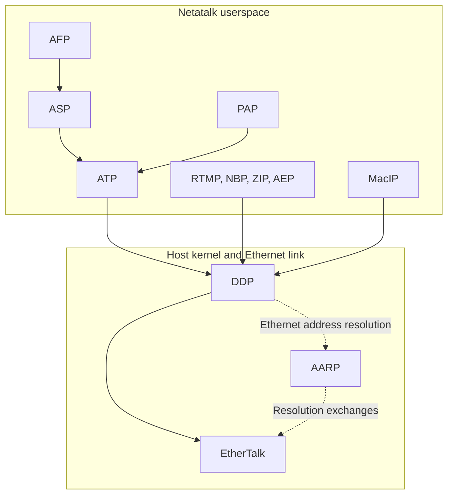
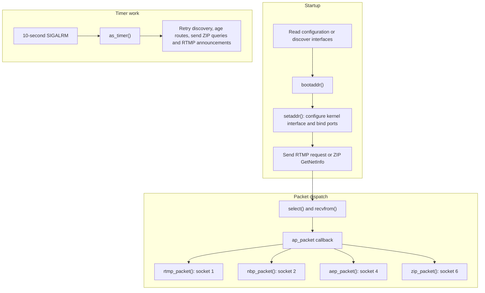
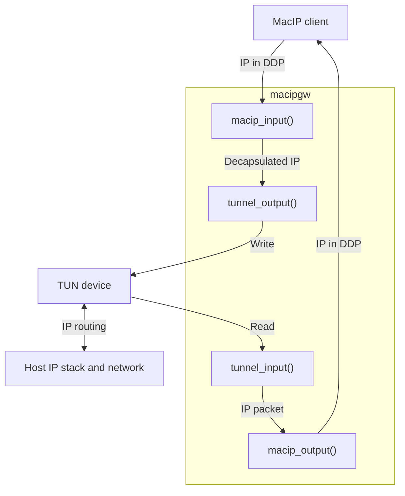

# AppleTalk Protocol Family

AppleTalk is a network protocol family for Macintosh and Apple II computers,
created by Apple in 1985 at a time when TCP/IP was not yet widely adopted.
It contains different protocols for different uses:
address resolution, address/name mapping, service location,
establishing connections, and the like.

The AppleTalk protocols are layered above the Datagram Delivery Protocol (DDP),
and using AppleTalk address format.
The AppleTalk family may provide SOCK_STREAM (ADSP), SOCK_DGRAM (DDP),
SOCK_RDM (ATP), and SOCK_SEQPACKET (ASP).

Netatalk implements the AppleTalk protocols to serve files over AFP and
provide other services to very old Mac and Apple II clients.

It supports EtherTalk Phase I and II, RTMP, NBP, ZIP, AEP, ATP,
PAP, and ASP, while expecting the host OS kernel to supply DDP.

- DDP is a socket to socket protocol that all other AppleTalk protocols
  are built on top of.
- ATP, ASP, and NBP are implemented as statically linked libraries
  in Netatalk's *libatalk* shared library.
- The **atalkd** daemon implements RTMP, ZIP, and AEP.
- The **papd** daemon implements PAP, allowing Mac clients to spool
  to a Unix print spooler or CUPS on the netatalk host computer.

The main protocol dependencies and the host networking boundary are:



ATP, the atalkd protocol handlers, and MacIP use DDP sockets. ZIP also uses
ATP for zone-list queries. AARP resolves AppleTalk destinations to Ethernet
addresses; DDP payloads travel in EtherTalk frames. The link-layer details
and address resolution belong to the host networking implementation.

## Implementation boundaries

AppleTalk support is optional and selected by Meson's `with-appletalk`
option. The build uses `enable_appletalk` to select components and defines
`NO_DDP` when support is disabled. Building userspace services does not add
DDP support to the host kernel.

| Location | Responsibility |
| --- | --- |
| `etc/atalkd/` | Interface/address acquisition, routing, zones, NBP, and echo |
| `libatalk/atp/`, `libatalk/asp/`, `libatalk/nbp/`, `libatalk/netddp/` | Transactions, sessions, name-service client routines, and socket helpers |
| `etc/afpd/afp_asp.c` | AFP request processing over ASP |
| `etc/papd/` | PAP printing sessions and spooler integration |
| `contrib/timelord/`, `contrib/a2boot/`, `contrib/macipgw/` | Time, Apple II boot, and MacIP gateway services |
| `sys/netatalk/` | Historical BSD kernel sources and compatibility headers |

The current Meson build installs compatibility headers from `sys/netatalk/`;
it does not build or install that historical DDP/AARP kernel implementation.
Read its kernel internals in that historical context. The platform's
runtime DDP support is a separate dependency.

AppleTalk services have independent service integration. The `netatalk`
controller supervises AFP infrastructure rather than these standalone daemons.
See [Netatalk Controller Daemon](netatalk.md).

## atalkd startup and dispatch

`atalkd` reads interface configuration, acquires addresses and cable-range/
zone information, configures kernel interfaces, and binds well-known DDP
sockets. Its service table dispatches RTMP, NBP, ZIP, and AEP packets.
Timers maintain routes, retry zone discovery, and announce routing state.
Key implementation files are `main.c`, `config.c`, `rtmp.c`, `nbp.c`,
and `zip.c` under `etc/atalkd/`.



Startup proceeds through these steps in `etc/atalkd/main.c`:

1. main() builds the interface list from readconf(), falling back to
   getifconf() when the configuration cannot be read. It applies phase and
   network-range defaults and starts bootaddr() with the first interface.
2. bootaddr() calls setaddr() before sending discovery requests.
   setaddr() configures the kernel address with `SIOCSIFADDR`, reads back
   the selected address with `SIOCGIFADDR`, and opens and binds each
   interface's DDP ports. Later calls close and reopen those ports.
3. A non-loopback Phase 1 interface sends rtmp_request() to discover its
   network; Phase 2 sends zip_getnetinfo() to discover the cable range and
   zone. Loopback is marked configured immediately. Reply handlers and
   timer fallback paths complete configuration and advance to the next
   interface.
4. as_timer() runs every ten seconds through `SIGALRM`. It retries startup
   discovery, handles missing routers according to seed/router state, ages
   learned routes, queries missing zones, and sends routing announcements
   on router interfaces. Once routing and zone discovery settle, it writes
   the learned configuration; a timeout can also end the stability wait
   without writing it.

The receive loop dispatches through each port's `ap_packet` callback.
`SIGALRM` and `SIGUSR1` are blocked while a packet handler runs. Timer work
runs in the signal handler rather than as a receive-loop callback. The
diagram shows the default socket numbers; setaddr() first checks the
system service database with getservbyname() for the `ddp` protocol.

Phase 1 and Phase 2 affect network addressing, cable ranges, and zone
handling. Available link layers and phase support also depend on the kernel.
Phase 1 should not be equated exclusively with LocalTalk, nor does an
Ethernet attachment prove Phase 2 operation.

## Service discovery through NBP

NBP advertises named entities in `object:type@zone` form. Service
registration and discovery are separate from establishing a session and
authenticating a user. The library's NBP client routines and atalkd's NBP
packet handler have different roles.

Services register their listening addresses through nbp_rgstr(). The
registration sites show which names clients can look up:

| Service | NBP object | NBP type | Registration site |
| --- | --- | --- | --- |
| AFP over ASP | Configured server name, falling back to hostname | `AFPServer` | `etc/afpd/afp_config.c` |
| PAP printer | Printer's configured name | Configurable; defaults to `LaserWriter` | `etc/papd/main.c` |
| Time service | Hostname by default; overridable with `-n` | `TimeLord` | `contrib/timelord/timelord.c` |
| Apple IIgs boot blocks | Hostname by default; overridable with `-n` | `Apple //gs` | `contrib/a2boot/a2boot.c` |
| Apple IIe boot blocks | Same a2boot server name | `Apple //e Boot` | `contrib/a2boot/a2boot.c` |
| ProDOS16 image | Same a2boot server name | `ProDOS16 Image` | `contrib/a2boot/a2boot.c` |
| MacIP gateway | Gateway's IP address in dotted-decimal form | `IPGATEWAY` | `contrib/macipgw/macip.c` |

AFP, PAP, and MacIP can select a zone; timelord and a2boot register in `*`,
the local zone. A discovered name supplies an address for the service's
protocol exchange; it does not establish an authenticated AFP session.

## Transactions, sessions, and auxiliary services

ATP supplies request/response transactions, response segmentation,
retransmission, and exactly-once transaction support. ASP builds session
open, command, write, tickle, attention, and close behavior above ATP.
`afp_asp.c` connects that transport to AFP handlers, while `afp_dsi.c`
provides the TCP session loop. Changes shared by both transports must not
assume DSI buffers, hint channels, or worker-loop behavior are universal.

PAP also uses ATP. `papd` registers printers through NBP, accepts sessions,
and spools their contents through the selected printing integration.
`timelord` answers time requests, `a2boot` serves boot blocks/images, and
`macipgw` bridges encapsulated IP traffic between DDP and a TUN device.
Gateway tunnel implementations depend on the host platform.

Configuration and service setup belong in the
[AppleTalk user manual](https://netatalk.io/manual/en/AppleTalk.html).
Wire constants and structures are documented in their headers instead of
being repeated here.

### MacIP packet flow

`macipgw` selects on its DDP socket and TUN descriptor in
`contrib/macipgw/main.c`. The two packet directions use output callbacks
installed during startup:



macip_open() installs tunnel_output() as the callback for received IP
payloads. tunnel_open() installs macip_output() as the callback for IP
packets read from TUN. The DDP receive path also handles ATP configuration
requests and NBP address lookups; the diagram shows the IP forwarding
path. A select timeout calls macip_idle() for address-lease maintenance.
The tunnel operations are implemented separately in `tunnel_linux.c` and
`tunnel_bsd.c` under `contrib/macipgw/`.

## Addressing

AppleTalk addresses are three byte quantities, stored in network byte
order. The include file <netatalk/at.h\> defines the AppleTalk
address format.

Sockets in the AppleTalk protocol family use the following address
structure:

```c
struct sockaddr_at {
    short sat_family;
    unsigned char sat_port;
    struct at_addr sat_addr;
    char sat_zero[8];
};
```

The port of a socket may be set with **bind**. The node for *bind* must
always be ATADDR_ANYNODE: "this node." The net may be
ATADDR_ANYNET or ATADDR_LATENET. ATADDR_ANYNET corresponds to the
machine's "primary" address (the first configured). ATADDR_LATENET
causes the address in outgoing packets to be determined when a packet is
sent, i.e. determined late. ATADDR_LATENET is equivalent to opening
one socket for each network interface. The port of a socket and either
the primary address or ATADDR_LATENET are returned with
**getsockname**.

## AppleTalk address parsing

The **atalk_aton()** routine converts an ASCII representation of an
AppleTalk address to a format appropriate for system calls. Acceptable
ASCII representations include both hex and base 10, in triples or
doubles. For instance, the address \`0x1f6b.77' has a network part of
\`8043' and a node part of \`119'. This same address could be written
\`8043.119', \`31.107.119', or \`0x1f.6b.77'. If the address is in hex
and the first digit is one of \`A-F', a leading \`0x' is redundant.

## NBP name parsing

**nbp_name()** parses user supplied names into their component object,
type, and zone. *obj*, *type*, and *zone* should be passed by reference,
and should point to the caller's default values. **nbp_name()** will
change the pointers to the parsed-out values. *name* is of the form
object:type\@zone, where each of *object*, *:type*, and *\@zone*
replace *obj*, *type*, and *zone*, respectively. *type* must be
proceeded by \`:', and *zone* must be preceded by \`\@'.

## DDP Implementations

### Linux

The Linux kernel introduced DDP support in version 1.3, released in June 1995.
See the [Linux 1.3.0 Changes file](https://www.kernel.org/pub/linux/kernel/v1.3/).

As of version 7.2 of the Linux kernel, the *appletalk* module was moved from the kernel source tree
to the [orphaned modules](https://github.com/linux-netdev/mod-orphan/tree/main/net/appletalk) repository.
If you're using a Linux kernel version 7.2 or later,
you will need to build and install the *appletalk* module from that repository.

### NetBSD

Kernel support for DDP appeared in NetBSD 1.3 in April 1997.
See the [NetBSD 1.3 release notes](http://www.netbsd.org/changes/changes-1.3.html)

The NetBSD kernel module is confusingly named *netatalk* and is located under
[sys/netatalk](https://cvsweb.netbsd.org/bsdweb.cgi/src/sys/netatalk/) in the NetBSD source tree.

### Solaris

Historical versions of Netatalk (until v2.3) distributed code for a Solaris STREAMS module that implements DDP.

The source code is located under
[sys/solaris](https://github.com/Netatalk/netatalk/tree/branch-netatalk-2-3/sys/solaris)
in the netatalk source tree.
It is written for the SPARC architecture.

### Generic

If you would like DDP support on another operating system,
you will need either need a kernel module for your operating system,
or a userland AppleTalk stack.

Look at the above Solaris STREAMS module if your operating system supports that framework.
Otherwise, look at the DDP code in NetBSD if your operating system is BSDish in nature.

If your operating system looks different than these two cases,
you'll have to roll your own implementation.
