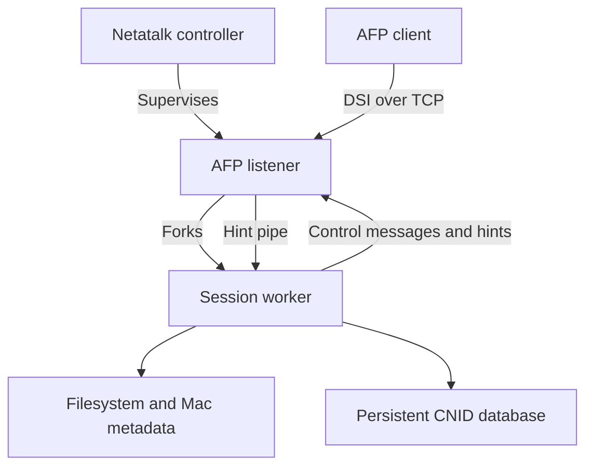

# Developer Documentation

Netatalk is a Free and Open Source AFP (Apple Filing Protocol) server for
Unix-like systems. It serves Mac-style file identity, metadata, and resource
forks over TCP and optionally AppleTalk. This manual explains the architecture
and implementation contracts useful when changing the server and its tools.
See the [user manual](https://netatalk.io/manual/en/) for installation,
configuration, and administration.

## Architecture Overview

Netatalk separates service supervision, connection handling, and client
sessions. Shared libraries provide protocols, storage, character conversion,
and database access used by daemons and utilities.

### Process ownership

| Process | Responsibility | Implementation guide |
| --- | --- | --- |
| `netatalk` controller | Supervise AFP infrastructure and advertise services | [Netatalk Controller Daemon](netatalk.md) |
| `afpd` listener | Accept connections and track session workers | [AFP Daemon](afpd.md) |
| AFP session worker | Own client identity, open volumes/forks, transport buffers, and caches | [AFP Daemon](afpd.md), [Request Processing](request-flow.md) |

Workers share persistent files and CNID records while retaining their own
runtime state. AppleTalk services are managed separately from the AFP
controller; see [AppleTalk](ddp.md).

AFP defines file operations, while DSI over TCP or ASP over ATP/DDP carries
them to the server's handlers. The host kernel supplies TCP/IP and optional
DDP networking. Service discovery advertises availability separately from
transport setup, authentication, and volume authorization.

A volume has its own storage and access policy. Persistent CNIDs identify
objects across supported renames and moves. AppleDouble and extended
attributes preserve Mac metadata/resource forks, separately from the CNID
database. Filename conversion relates legacy Mac and Unicode names to host
paths. Changes to a file operation must preserve these relationships and
invalidate the corresponding worker caches.

### Lifecycle boundaries

Several transitions affect different parts of a session. Changes must
preserve the state owned on both sides of each boundary.

| Transition | Contract and further reading |
| --- | --- |
| Connection to login | An accepted transport does not establish a serving identity; [Authentication](authentication.md) defines admission and identity changes |
| Volume definition to mount | Parsing a share does not open its storage, CNID, or query handles; see [Volume Lifecycle](volumes.md) |
| Request to persistent mutation | Filesystem, identity, metadata, and cache effects must agree; see [Request Processing](request-flow.md) |
| Transport loss to retained session | A worker can retain authenticated open state for reconnect; [AFP Daemon](afpd.md) defines the state and transfer paths |
| Reload to reused volume | Signaling processes does not reconstruct every open volume; see [Configuration Internals](configuration.md) |
| Volume close to process exit | Per-volume cleanup must preserve the remaining session; session exit can release all worker state; see [Volume Lifecycle](volumes.md) and [AFP Daemon](afpd.md) |

For single-user startup validation and its restart requirements, see
[Netatalk Controller Daemon](netatalk.md).

## Reading Guide

Start with [Netatalk Controller Daemon](netatalk.md) and [AFP Daemon](afpd.md)
for process behavior, then [AFP Request Processing](request-flow.md) to follow
an operation. Use the chapters below for the state those operations own.

| Topic | Developer guide |
| --- | --- |
| Service supervision, event libraries, and discovery | [Netatalk Controller Daemon](netatalk.md) |
| Listener loop, worker state, and open-fork tracking | [AFP Daemon](afpd.md) |
| Persistent IDs and backend errors | [Persistent File Identity](cnid.md) |
| Cache validity, hints, and idle-worker ownership | [Caching and Consistency](caching.md) |
| Parsing, inheritance, validation, and reload | [Configuration Internals](configuration.md) |
| Share definitions, runtime handles, and access policy | [Volume Lifecycle](volumes.md) |
| UAM callbacks, serving identity, and reconnect authorization | [Authentication and Session Identity](authentication.md) |
| Metadata formats, resource forks, VFS, and locking | [Mac Metadata and Fork Storage](appledouble.md) |
| Server, desktop database, and virtual volume icons | [Icons](icons.md) |
| TCP framing and AppleTalk integration | [DSI](dsi.md), [AppleTalk](ddp.md) |
| Search backends and query ownership | [Indexed Spotlight Search](indexing.md) |
| Shared library use and a worked metadata-copy example | [Using libatalk](libatalk.md) |
| Error handling, diagnostics, and measurement | [Logging and Diagnostics](logging.md), [Performance Analysis](profiling.md) |

## Source Orientation

| Directory | Main responsibility |
| --- | --- |
| `etc/afpd/` | Listener, session workers, AFP handlers, and worker caches |
| `etc/netatalk/` | Controller and service discovery |
| `etc/uams/` | Loadable authentication modules |
| `etc/spotlight/` | Search backend implementations |
| `libatalk/`, `include/atalk/` | Shared implementations and API declarations |
| `bin/` | Utilities such as `dbd`, `nad`, and `afppasswd` |
| `etc/atalkd/`, `etc/papd/` | AppleTalk services |
| `contrib/` | Auxiliary programs |
| `test/` | Unit tests, AFP protocol clients, integration scripts, and fuzzing |

Meson options determine which optional components a build includes. The
presence of a source file does not establish runtime availability.

These chapters explain architecture and implementation contracts. Use the
generated file, type, and function references for API details and the
[OKF Knowledge Graph](okf-knowledge-graph.md) for callers, dependencies, and
hotspots. Confirm graph findings in the current source. Test selection and
execution instructions live in `test/README.md`.
