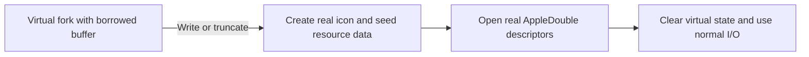

# Icons

Netatalk supplies icon resources for clients through several AFP interfaces.
Built-in artwork can appear in server status or in a synthesized volume-root file.
AFP desktop database commands also store and retrieve application icons.
These paths have different ownership and wire/storage formats.

## Key modules

| Location | Responsibility |
| --- | --- |
| `etc/afpd/icon.c`, `etc/afpd/icon.h` | Built-in pixel arrays, resource types, and sizes |
| `etc/afpd/status.c` | Server-status icon and mask |
| `etc/afpd/desktop.c` | Desktop database icon commands |
| `etc/afpd/virtual_icon.c`, `etc/afpd/virtual_icon.h` | Synthetic volume icon and resource-fork builder |
| `etc/afpd/fork.c`, `etc/afpd/ofork.c`, `etc/afpd/filedir.c`, `etc/afpd/enumerate.c`, `etc/afpd/directory.c` | Virtual-file integration with normal AFP operations |

## Built-in resources

The shared artwork in `icon.c` has three classic Mac representations:

| Resource | Representation |
| --- | --- |
| `ICN#` | 32 by 32 monochrome bitmap plus a matching mask; 256 bytes |
| `icl4` | 32 by 32 indexed 4-bit color, high nibble first; 512 bytes |
| `icl8` | 32 by 32 indexed 8-bit color; 1,024 bytes |

The color arrays use the classic system palettes. These arrays are raw
resource data, with dimensions implied by type; they are not complete
resource forks or modern image containers. `icon.h` supplies the common
declarations and sizes used by both consumers.

## Server-status icon

status_init() chooses the built-in monochrome artwork using the Global
`legacy icon` setting. The TCP status response defaults to the fileserver
icon. status_icon() writes its bitmap/mask into the server-information
block and records its offset; it does not wrap the bytes in a resource fork.
The ASP status response omits the default icon when no custom selection is
configured to conserve response space.

This status path does not require an open volume or a physical `Icon\r`
file. Adding volume icons must not disturb status offsets, the server
signature, or the response-size constraints.

## Desktop database icons

afp_addicon(), afp_geticoninfo(), and afp_geticon() implement the AFP desktop
icon interface in `desktop.c`. They operate on creator-associated icon
records in the volume's AppleDesktop database. They store client-supplied
icon information rather than selecting the built-in status artwork.

Keep record sizes, file offsets, locking, and missing-record/error behavior
consistent across add and read paths. Desktop database icons are distinct
from Finder's custom-volume resource ID and the synthetic root file below.

## Virtual volume icon

Finder recognizes a custom volume icon through a root file named `Icon\r`
(the last character is carriage return) and the root's `hasCustomIcon`
Finder flag. With a volume `legacy icon` selection, virtual_icon_init()
builds an in-memory resource fork from the built-in arrays. The volume owns
the buffer; virtual open forks borrow it.

The builder writes a resource header, length-prefixed resource data, and a
resource map in big-endian form. The three resources share the Finder custom
icon ID, -16455. Keep offsets, lengths, and resource-map references aligned
with the actual data; a pixel array alone is not a valid resource fork.
The detailed layout is documented beside the builder.

The synthetic file uses reserved `VIRTUAL_ICON_CNID`, below ordinary CNID
allocation. Its data fork is empty and its resource fork contains the built
data. Normal database allocation must not claim that synthetic identity.

| AFP operation | Virtual behavior |
| --- | --- |
| Enumeration and root parameters | Append the root entry, include it in the offspring count, and expose the custom-icon flag |
| File/fork parameters | Synthesize consistent identity, attributes, and fork sizes |
| Open/read | Allocate a virtual fork reference and serve the borrowed resource buffer |
| Close | Release the virtual reference without ordinary descriptor flush/close |
| Write/truncate with write access | Materialize the icon and continue through stored-fork I/O |
| Delete/rename/move/set file parameters | Reject operations intercepted on the purely virtual icon |

The guards include volume-root location, matching name or synthetic ID as
appropriate, feature enablement, and absence of a real icon. A real root
`Icon\r` file takes precedence. Enumeration, counts, direct lookup, and
fork parameters must agree on whether the synthetic entry is visible.

## Materialization and lifetime

A write-capable open initially remains virtual. The first write or truncate
calls materialize_virtual_icon(), which creates the root file, seeds the
resource fork and Finder metadata, reopens the selected fork, and updates
the open-fork identity before clearing its virtual fields.

This is not an atomic storage transaction. Some seeding failures log warnings
and continue. A failed reopen removes the created pathname and reports an
error, without promising rollback of every metadata side effect. Preserve
the distinction between a virtual borrowed buffer and owned real descriptors
on all success and failure paths. See [Mac Metadata and Fork Storage](appledouble.md).

Once a real file exists, subsequent pathname operations use normal storage.
Removing it can expose the configured virtual icon again. Volume teardown
must respect outstanding borrowed pointers when releasing its icon buffer.

## Adding artwork and checking integration

Add matching monochrome/mask, 4-bit, and 8-bit arrays to `icon.c` and
declarations to `icon.h`. Update both selection paths in `status.c` and
virtual_icon_init() if the theme should work in both contexts. The helper
`contrib/scripts/icn_hex_to_c.pl` can assist with converting resource hex
data to C arrays; arbitrary PNG bytes cannot be used directly.

Check exact array lengths, mask alignment, and palette indices. Verify server
status over the supported transports separately from volume-root
enumeration, parameters, resource reads, and write/truncate materialization.
Include a real-icon precedence case and read-only/write-denied requests.
AFP desktop icon command tests live under `test/testsuite`.
