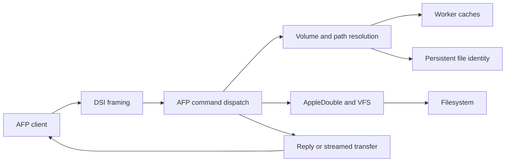

# Request Processing

An AFP session worker receives a request, resolves the client's objects,
performs the operation, and replies directly to the client. The controller
does not relay file data. This chapter follows the boundaries an operation
crosses; individual APIs are documented with their source.

## Key modules

| Location | Responsibility |
| --- | --- |
| `etc/afpd/afp_dsi.c`, `etc/afpd/switch.c` | Worker loop and AFP command dispatch |
| `etc/afpd/directory.c`, `etc/afpd/enumerate.c` | Path/CNID resolution and directory enumeration |
| `etc/afpd/file.c`, `etc/afpd/filedir.c`, `etc/afpd/fork.c` | File mutations, parameters, and fork I/O |
| `libatalk/dsi/`, `libatalk/adouble/` | Transport framing and stored fork access |
| `etc/afpd/fce_api.c` | External file events API |
| `etc/afpd/spotlight/` | External search backend integration |

## From a connection to an authenticated command

The worker dispatches an AFP command only when its current command table
permits it. [AFP Daemon](afpd.md) describes connection setup, dispatch-table
selection, and replay behavior; [Authentication](authentication.md) covers
the identity and policy checks that precede authenticated operations.
Transport negotiation and framing are described in [DSI over TCP](dsi.md).

## Volume and object resolution

The session must open a volume before operating on its files. afp_openvol()
initializes runtime state such as the CNID connection, root directory,
and optional icon/search state. A configured volume definition and an open
volume have different lifetimes; see [Volume Lifecycle](volumes.md).

cname() and dirlookup() resolve AFP paths and directory IDs. They combine
worker cache state, persistent CNID records, and filesystem information.
A failed database query must remain distinguishable from an absent file;
otherwise a temporary failure can become a permanent missing-object reply.
See [Persistent File Identity](cnid.md).

Filename conversion crosses a separate boundary. Legacy Mac names and AFP
3.x UTF-8 names take different conversion paths in `libatalk/unicode/`.
Normalization, case handling, and mangling must preserve the relationship
between client names, filesystem names, and CNID records.

## Open, read, write, and close

afp_openfork() checks access and deny modes, opens the selected fork, and
allocates an open-fork reference. [AFP Daemon](afpd.md) describes reference
tracking and shared-object ownership;
[Mac Metadata and Fork Storage](appledouble.md) covers descriptors and locks.

| Operation | Main path and required state |
| --- | --- |
| Read | Resolve the open fork, check locks, then use cached resource data, AppleDouble I/O, or an eligible sendfile path; stream the reply through DSI |
| Write | Validate access and offset, consume the DSIWrite payload, write through AppleDouble or eligible recvfile, and mark/invalidate changed state |
| Flush / close | Persist required data/metadata, release locks and descriptors, update notifications, and release the fork reference |

Incoming DSI readahead is network buffering, not filesystem read-ahead.
Sendfile and recvfile depend on platform, build, and storage eligibility;
enabling an option does not select that path for every fork.

Write failure handling must preserve the next frame boundary. The recvfile
path tracks socket bytes consumed separately from file bytes persisted.
It discards consumed pipe data and drains remaining write data on failure.
The next request must not be parsed from a leftover write payload.

## Enumeration and mutations

Enumeration reads directory entries and packs only the requested AFP
parameters. Stat and metadata reuse depend on the path and cache validity;
a successful directory-cache lookup does not imply every parameter needs
no filesystem access. A configured virtual icon adds a synthetic root
entry, which must agree with root counts and parameter replies.

Create, delete, rename, and move operations affect more than the pathname.
Review filesystem state, CNID mappings, local cached names/stat/metadata,
open-fork state, and notifications together, including partial failures.

| Notification | Consumer and purpose |
| --- | --- |
| Ordinary cache hint | Sibling workers under the same listener; best-effort cache repair |
| CNID reset hint | Sessions using the reset identity space; end sessions so clients discard old IDs |
| FCE | Configured external event listeners or scripts |
| Search index event | The selected backend's incremental indexing hook, where implemented |

These mechanisms have different delivery and recovery behavior. External
FCE delivery does not establish internal cache consistency. See
[Caching and Consistency](caching.md), [Icons](icons.md), and
[Indexed Spotlight Search](indexing.md).

## Errors

Transport, filesystem, metadata, and CNID errors are interpreted at their
callers. Preserve each API's error contract and complete its cleanup before
forming an AFP reply. Do not collapse all failures into missing-object
errors or assume that an error reply rolled back earlier side effects.
